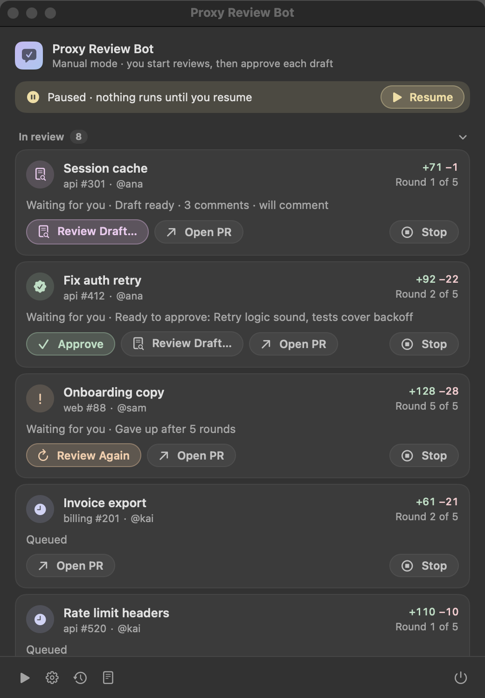
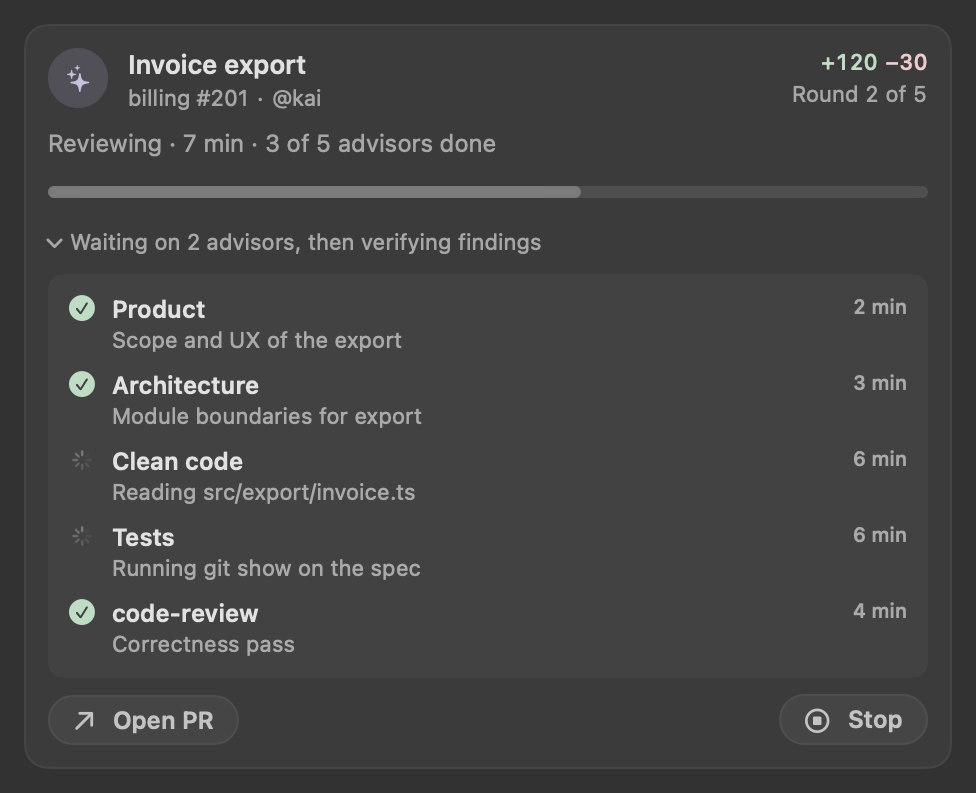
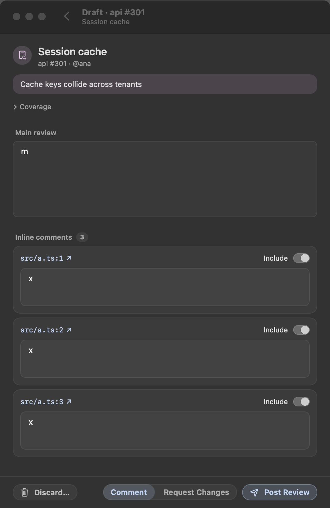
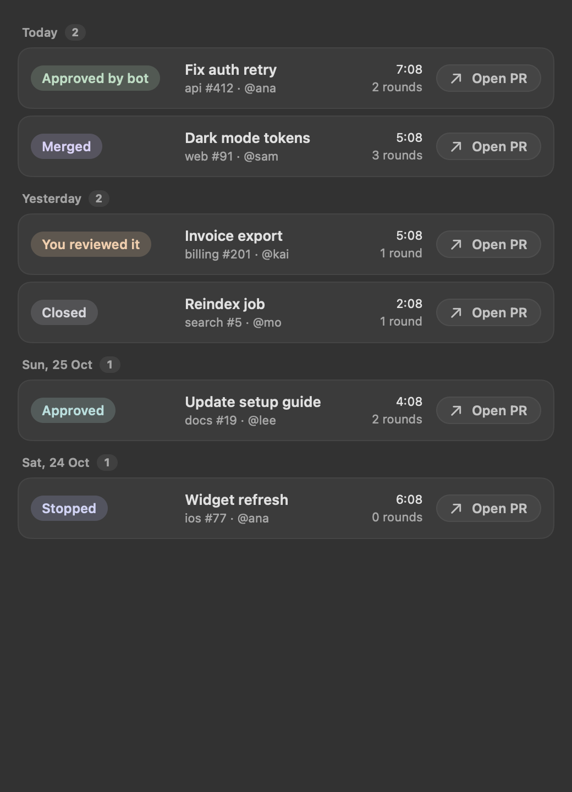

[](https://github.com/FurlanLuka/proxy-review-bot/releases/latest)
[](#what-you-need-and-where-your-data-goes)
[](https://github.com/FurlanLuka/proxy-review-bot/actions/workflows/test.yml)
[](LICENSE)

**Your PR reviews, drafted while you work.** When someone requests your review on GitHub, Proxy
Review Bot reviews the PR with [proxy](https://github.com/FurlanLuka/claude-proxy-plugin)'s
`pr-review` skill, on your own Claude Code login, and hands you a draft to check. You edit it, pick
Approve, Comment or Request Changes, and post. When the author pushes again, it reviews the new
commits and you get the next draft.

It runs on your Mac, in the menu bar, using the `gh` login you already have. There's no server, no
GitHub App and no webhook: it checks GitHub once a minute and keeps everything local.

[Try it](#try-it) · [What it's like](#what-its-like-to-use) · [Safety](#what-it-will-and-wont-do) ·
[Underneath](#how-it-works-underneath) · [Where it stands](#where-it-stands) ·
[Releases](https://github.com/FurlanLuka/proxy-review-bot/releases)

## Try it

```bash
curl -fsSL https://raw.githubusercontent.com/FurlanLuka/proxy-review-bot/main/install.sh | sh
```

The installer puts the app in `~/Applications`, adds a login item so it starts with your Mac and
comes back if it crashes, and opens it. Click the icon in the menu bar. If something is missing (Claude Code
not logged in, the proxy plugin not installed, `gh` not logged in) the window lists it with the
exact command that fixes it.

It starts in **manual mode**: nothing is reviewed until you click **Review**, and nothing is posted
until you post it.

## What it's like to use

PRs that request your review show up under **Ready to review**. Click **Review** and the bot starts.
Up to three reviews run at once, and you can watch each one's advisors work through it.



From then on the PR stays under **In review** until it's done, and its card always says which step
it's at and which round it's on:

- **Waiting for you**: a draft is ready, or an approval is waiting for your click.
- **Reviewing** or **Queued**: the bot is on it.
- **Waiting on author**: your review is posted and the author has the next move.

When the author pushes new commits or re-requests your review, the next round starts by itself: the
bot checks whether its earlier comments were addressed and reviews what changed, until the PR is
approved, merged or closed, or it hits the round limit (5 by default). If someone replies in one of
the bot's comment threads, it answers there.

**Review Draft…** opens the draft in the same window. Edit the main comment and each inline comment,
drop the ones you don't want, jump to the line on GitHub, then post.



**History** shows how each PR ended over the last 30 days: approved by the bot, approved, merged,
closed, reviewed by you, or stopped.



In **Settings** you can switch to **auto mode**, where comment reviews post on their own; choose
whether approvals post on their own too (never, always, or only for small PRs); limit which orgs and
repos it watches; and set the round limit and how often it checks.

## What it will and won't do

- **In manual mode nothing posts without you.** Every finished review is a draft first.
- **Approvals wait for your click** unless you turn auto-approve on, and before approving it checks
  the PR head hasn't moved since the review.
- **Claude can read, never write.** Reviews run with read-only tools, and the `gh` and `git` that
  Claude sees are guards that block every write. Only the bot itself posts, after you've seen the
  draft (or in auto mode).
- **A PR's own files can't run code.** The guards start outside the checked-out repo and ignore its
  `.env`, `bunfig.toml` and `BUN_OPTIONS`.
- **It steps back when you step in.** If you review a PR yourself, the bot stops on it.
- **Its posts are marked**, with a "🤖 review bot" line and a hidden marker, so it never answers
  itself or posts the same review twice.
- **Reviews bill your Claude subscription.** `ANTHROPIC_API_KEY` is removed from every run.
- **A review that finishes without a usable answer isn't thrown away.** The bot resumes that same
  Claude session and asks for the result (up to 5 tries) instead of reviewing again, and anything
  recovered this way is always held as a draft for you.

## How it works underneath

Two pieces ship together in the app:

- **`service/`** is a TypeScript service, compiled with Bun into one binary inside the app. It
  polls GitHub through `gh`, keeps its state in SQLite, runs reviews and posts them. The app talks to
  it over a local HTTP API ([docs/service-api.md](docs/service-api.md)).
- **`app/`** is the SwiftUI app: the menu bar icon, the window and the settings. It starts the
  service and stops it when you quit.

Each review runs `claude -p "/proxy:pr-review <url>"` in its own git worktree of the PR's repo,
asks for a structured result (summary, main comment, inline comments, a proposed filing), and the
service turns that into a draft or a post. Reviews keep their Claude Code session, so a result that
comes back malformed can be asked for again without redoing the work.

## Where it stands

I use it every day for the reviews I'm asked for at work. It's young and changes quickly, so expect
things to move; the [release notes](https://github.com/FurlanLuka/proxy-review-bot/releases) say
what changed. Every change goes through about 480 service tests, 90 app tests, and a check of the
built app that the guards still block writes, before it's released.

It reviews PRs that request you. Pasting any PR link (your own included) is next.

## What you need, and where your data goes

- macOS 14 or later on Apple silicon.
- [GitHub CLI](https://cli.github.com) (`gh`), logged in, and `git`.
- [Claude Code](https://code.claude.com/docs), logged in with your subscription.
- The [proxy](https://github.com/FurlanLuka/claude-proxy-plugin) plugin, 1.6 or later:
  `/plugin marketplace add FurlanLuka/claude-proxy-plugin`, then `/plugin install proxy@proxy-marketplace`.

Nothing else is installed: the service and its runtime ship inside the app.

The PR content goes to Anthropic through Claude Code, as with any review you'd run yourself, and
reviews are posted to GitHub through `gh`. Everything else stays on your Mac:

| What | Where |
|---|---|
| Settings, database, repo clones | `~/Library/Application Support/ProxyReviewBot/` |
| Logs (JSON lines, rotated at 5 MB) | `~/Library/Logs/ProxyReviewBot/service.log` |
| Results Claude returned malformed (newest 10) | `~/Library/Application Support/ProxyReviewBot/failed-results/` |
| Review sessions | `~/.claude/projects/`, cleaned up by Claude Code's normal retention |

Review sessions contain the PR's content, which comes from its author, so treat them like the PR.
To look inside one, run `claude --resume <sessionId>` with the id from the `repair_started` line in
the log.

## Updating and uninstalling

Run the install command again to update; your settings and history stay. To uninstall, add
`--uninstall`, and `--purge` to also delete settings, the database and logs:

```bash
curl -fsSL https://raw.githubusercontent.com/FurlanLuka/proxy-review-bot/main/install.sh | sh -s -- --uninstall
```

You can also uninstall from Settings.

## Developing

You need Bun 1.4.2 and the Swift toolchain (Xcode or the command line tools).

```bash
cd service && bun install && bun run check && bun test
cd ../app && swift test
app/scripts/build-app.sh                  # → app/build/ProxyReviewBot.app
```

Run the service on its own, on throwaway data:

```bash
cd service
PRB_DATA_DIR=/tmp/prb PRB_TOKEN=dev bun --no-env-file src/entry.ts
curl -H 'Authorization: Bearer dev' http://127.0.0.1:<port>/state
```

Install a local build: `(cd app && ZIP_OUTPUT=/tmp/prb.zip scripts/build-app.sh) && PRB_LOCAL_ZIP=/tmp/prb.zip sh install.sh`.

To release, push a version tag (`git tag v0.4.3 && git push origin v0.4.3`). CI tests both halves,
builds and signs the app, checks the built binary's guards, and publishes the release.

## License

[MIT](LICENSE)
