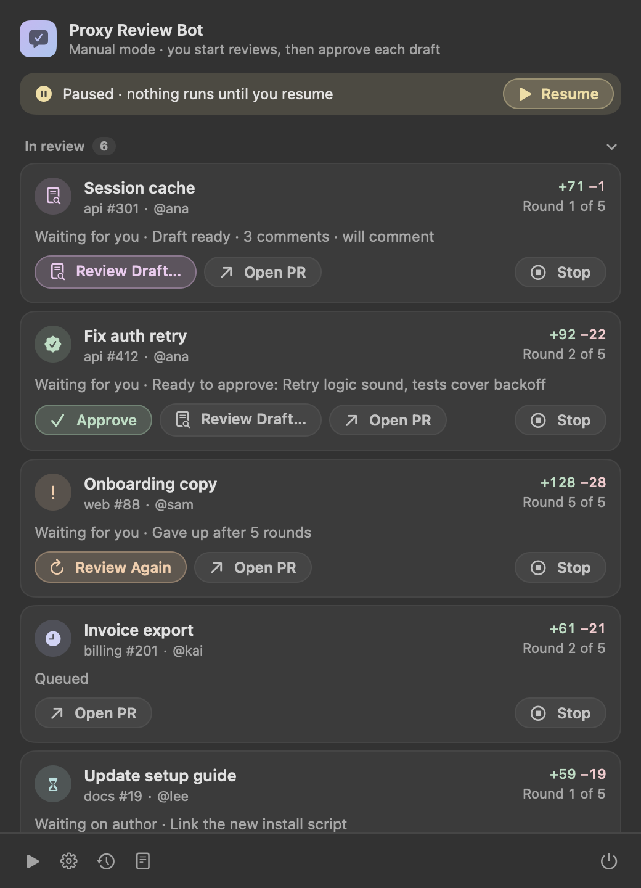

# Proxy Review Bot

A local macOS menu bar bot that reviews GitHub pull requests where you are personally requested, using the `proxy:pr-review` skill through `claude -p` on your Claude subscription. It posts under your own `gh` login, re-reviews on new pushes until the PR is approved, merged or closed, and answers follow-up questions in threads it started.

- `service/`: a Bun + TypeScript service. It polls GitHub, runs reviews, posts them, and serves the local API in [docs/service-api.md](docs/service-api.md).
- `app/`: a SwiftUI menu bar app. It starts and supervises the service, lists what needs you, and holds the settings.



## What changed in 0.4.0

- Once you start a review, the PR stays in In review until it's done. New commits, a re-request (even on the same commit) and a failed run after its backoff start the next round on their own, also in manual mode. You still check and post every draft.
- Updating marks PRs that were already in progress as started, so they continue on their own.
- A re-request skips the quiet period.
- Switching from auto to manual mode keeps already-started PRs continuing.
- The menu bar icon opens a window instead of a dropdown. Drafts, History and Settings open inside it with Back.

## Requirements

- macOS 14 or later.
- Xcode or the Swift toolchain.
- Bun, at `~/.bun/bin/bun` or on PATH.
- `gh`, logged in.
- Claude Code, logged in with your subscription (`claude auth login`).
- The proxy plugin at version 1.6 or later, with the `pr-review` skill (`claude plugin update proxy@proxy-marketplace`).

The menu shows a **Setup needed** section with the fix command for anything that's missing.

## Install

```sh
curl -fsSL https://raw.githubusercontent.com/FurlanLuka/proxy-review-bot/main/install.sh | sh
```

If the repo is private, fetch the script through `gh` instead:

```sh
gh api repos/FurlanLuka/proxy-review-bot/contents/install.sh -H 'Accept: application/vnd.github.raw' | sh
```

The installer:

1. Checks for an Apple Silicon Mac on macOS 14 or later.
2. Checks for `gh` and `git`, and installs Bun if it's missing.
3. Downloads the latest release using your `gh` login, and installs it to `~/Applications/ProxyReviewBot.app`.
4. Adds a LaunchAgent (`~/Library/LaunchAgents/com.furlanluka.proxy-review-bot.plist`), so the app starts at login and restarts if it crashes. Quitting it from the menu keeps it quit until your next login.
5. Starts the app.

Run the same command again to update. To uninstall, pass `--uninstall`; add `--purge` to also delete settings, the database and logs:

```sh
curl -fsSL https://raw.githubusercontent.com/FurlanLuka/proxy-review-bot/main/install.sh | sh -s -- --uninstall
```

The **Launch at login** toggle in Settings adds or removes the same LaunchAgent.

### Releasing

Push a version tag. The Release workflow tests the service and the app, builds `ProxyReviewBot_<version>_macos_arm64.zip` and publishes the release:

```sh
git tag v0.1.0 && git push origin v0.1.0
```

To install a local build without a release:

```sh
(cd app && ZIP_OUTPUT=/tmp/prb.zip scripts/build-app.sh) && PRB_LOCAL_ZIP=/tmp/prb.zip sh install.sh
```

## Build and run

```sh
cd service && ~/.bun/bin/bun install
cd ../app && scripts/build-app.sh      # → app/build/ProxyReviewBot.app
open app/build/ProxyReviewBot.app
```

To develop the service on its own, without the app:

```sh
cd service
PRB_DATA_DIR=/tmp/prb PRB_TOKEN=dev ~/.bun/bin/bun src/main.ts
curl -H 'Authorization: Bearer dev' http://127.0.0.1:<port>/state
```

## Safety defaults

- **First launch is manual mode.** Nothing is reviewed until you click **Review**, or switch to Auto in Settings.
- **In manual mode nothing posts without you.**
  - A finished review becomes a draft (**Needs you → Review draft**).
  - You can edit the main comment and each inline comment, drop the ones you don't want, then post, approve or discard.
  - If the author pushes while the draft waits, the draft is dropped and the new commits get reviewed.
- **In auto mode, comment reviews post on their own.** Approvals still follow the auto-approve setting.
- **Auto-approve is off by default.** Approvals wait for your click in the menu, and the bot re-checks that the PR head hasn't moved before approving.
- **Claude runs read-only.** It runs with `--setting-sources user`, and its tools are limited to reading and subagents. `gh` and `git` are replaced by guards that block every write (`service/src/claude/command-guard.ts`), so only the service itself posts.
- **Bot posts are marked.** Each one carries a "🤖 review bot" line and a hidden `<!-- proxy-review-bot head=<sha> -->` marker. The marker is used to avoid posting twice and to tell the bot's threads from yours.
- **`ANTHROPIC_API_KEY` is removed** from every Claude run, so reviews bill your subscription.
- **The bot steps back when you step in.** If you post your own review on a PR, the bot stops on it and moves it to **Needs you**.

## Files

| What | Where |
|---|---|
| Settings | `~/Library/Application Support/ProxyReviewBot/settings.json` |
| Database | `~/Library/Application Support/ProxyReviewBot/bot.sqlite` |
| Repo clones the bot reviews in | `~/Library/Application Support/ProxyReviewBot/repos/` |
| Logs (JSON lines) | `~/Library/Logs/ProxyReviewBot/service.log` |

## Checks

```sh
cd service && ~/.bun/bin/bun run check && ~/.bun/bin/bun test
cd app && swift test
```
